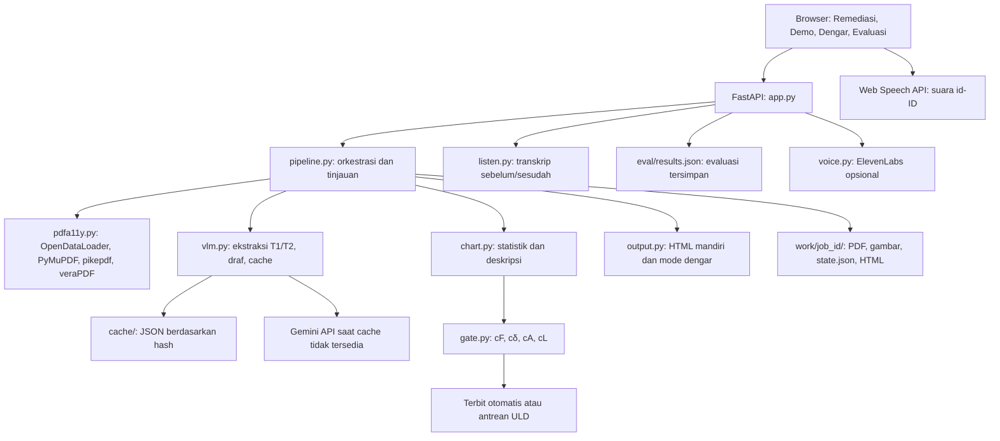

> Catatan historis sebelum implementasi cream. Status terkini dan hasil uji ada pada `tasks/implementation-cream.md` (relatif root Prototype). Temuan lama perlu dibaca sesuai versi sumbernya.

# Inspeksi arsitektur SIMAK

Tanggal: 23 Oktober 2026, WIB. Lingkup: kode aplikasi dan pemeriksaan browser lokal, tanpa perubahan implementasi.

## Status prototipe

Server berjalan di <http://127.0.0.1:8000>, satu proses Uvicorn, PID **37336**, hanya pada loopback. Log tersedia di `work/server.stdout.log` dan `work/server.stderr.log`. Perintah menjalankan ulang dari folder `Prototype`:

```powershell
python -m uvicorn app:app --host 127.0.0.1 --port 8000
```

Untuk menghentikan instance ini, verifikasi PID masih milik Uvicorn SIMAK sebelum menjalankan `Stop-Process -Id 37336`.

## Peta arsitektur



- **Frontend:** empat halaman statis, CSS/font lokal, JavaScript per halaman, serta `web/common.js` untuk navigasi, tampilan klaim, suara, dan perintah suara. Tidak memerlukan build frontend.
- **API:** menyajikan frontend dan API dari origin yang sama. Job PDF memakai thread latar; browser menanyakan progres setiap 1,2 detik.
- **Domain:** satu model elemen berbentuk dictionary dipakai pipeline, gerbang, tinjauan, dan perakit keluaran. Pemisahan perhitungan statistik dari teks VLM merupakan keputusan desain yang baik.
- **Penyimpanan:** progres aktif berada di dictionary `JOBS`; hasil selesai berada di JSON dan berkas lokal. State demo berada di dictionary `DEMO` berdasarkan ID grafik.
- **Keluaran:** PDF diperbaiki dan divalidasi; HTML menyertakan gambar/font secara tertanam. Transkrip Dengar disusun dari state yang sama. Evaluasi di web membaca hasil yang sudah tersimpan, bukan menjalankan evaluasi baru.

## Bukti pemeriksaan

| Pemeriksaan | Hasil teramati |
|---|---|
| Remediasi, Demo Gerbang, Dengar, Evaluasi | Keempat halaman berhasil dimuat |
| Daftar contoh | 6 PDF sintetis; PDF Common Crawl tidak tersedia pada instance ini |
| Ketersediaan demo | 60/60 grafik uji tersedia dalam cache; key VLM terdeteksi tersedia tanpa menampilkan nilainya |
| Proses `materi_01.pdf` melalui tombol browser | Selesai, job `d9bf7c1454`, 3 halaman, 9,67 detik |
| Katalog gambar hasil uji | 3 terbit otomatis, 2 antrean ULD, 2 dekoratif |
| veraPDF pada dokumen uji | B0: 6 aturan gagal; B1: 5; D: 0, compliant=true |
| G1 ketat pada dokumen uji | Tidak lulus karena 2 gambar masih memiliki penanda menunggu tinjauan; lulus veraPDF tidak berarti semua deskripsi sudah selesai |
| Keluaran PDF dan HTML | Keduanya HTTP 200; PDF 162.822 byte, HTML 246.012 byte |
| Demo `syn043` | Awalnya SIMAK terbit otomatis; pemeriksa B2 menandai 1 angka keliru |
| Injeksi satu angka melalui tombol demo | SIMAK menahan keluaran, B2 tetap terbit; papan skor 1/1 tertahan pada SIMAK |
| Dengar untuk job uji | 31 bagian asli, 24 bagian SIMAK; Web Speech API dan suara Microsoft Andika id-ID tersedia |
| Tampilan Remediasi dengan hasil pada viewport 390 px | Lebar dokumen 390 px, tidak ditemukan overflow horizontal |
| Unggah teks dengan nama/MIME PDF | Ditolak HTTP 400, `Berkas bukan PDF` |
| ID job tidak dikenal | HTTP 404 |
| ID elemen tinjauan tidak dikenal | HTTP 500; log `RuntimeError: coroutine raised StopIteration` |
| Resource awal Remediasi | HTML, CSS, JS, font, dan API termuat; `favicon.ico` HTTP 404 |

## Temuan menurut prioritas

### 1. P1 — Keputusan tinjauan dapat saling menimpa

**Bukti kode:** `simak/pipeline.py:286` membaca seluruh state, mengubah satu elemen, merakit ulang PDF/HTML, lalu menyimpan seluruh state. Tidak ada lock per job. `save()` pada baris 279 menulis langsung ke berkas tujuan. Endpoint tinjauan sinkron dapat dijalankan bersamaan oleh threadpool server.

Dua tab dapat membaca state awal yang sama, menyimpan keputusan pada elemen berbeda, lalu penulisan terakhir menghilangkan keputusan pertama. Berkas PDF, HTML, dan JSON juga tidak diterbitkan sebagai satu versi konsisten. Ini temuan analisis kode; balapan penulisan tidak dipicu terhadap data pengguna.

**Perbaikan terkecil:** kunci seluruh transaksi tinjauan per job, koordinasikan dengan penghapusan job, dan tulis ke berkas sementara sebelum penggantian atomik. Jika nanti memakai beberapa proses, lock thread saja tidak mencukupi; gunakan transaksi penyimpanan atau penguncian lintas proses.

### 2. P2 — Janji penghapusan setelah 6 jam belum dijalankan selama server aktif

**Bukti kode:** `app.py:30` mendefinisikan `_cleanup()`, tetapi satu-satunya pemanggilan ada di baris 36 saat modul dimuat. UI `web/index.html:66` menyatakan sesi dihapus setelah 6 jam.

Server yang terus hidup dapat menyimpan PDF melewati waktu tersebut. Cleanup juga memakai waktu modifikasi direktori, bukan waktu kedaluwarsa eksplisit; menulis ulang berkas yang sudah ada tidak selalu memperbarui waktu direktori. Dictionary `JOBS` tidak memiliki pembersihan berkala.

**Perbaikan terkecil:** jalankan cleanup berkala dalam lifecycle aplikasi, gunakan waktu kedaluwarsa yang jelas, sinkronkan dengan job aktif/tinjauan, dan hapus entri memorinya. Jika timer belum dibuat, sesuaikan teks UI dengan perilaku sebenarnya.

### 3. P2 — Beban unggah dan pemrosesan belum dibatasi secara global

**Bukti kode:** `app.py:85` membaca seluruh unggahan ke memori. `_start()` pada baris 45 membuat thread baru untuk setiap job; `simak/pipeline.py:236` menambah hingga 6 worker gambar per job. Tidak ada antrean global atau batas ukuran/jumlah halaman yang diterima aplikasi.

Beberapa unggahan dapat memperbesar pemakaian RAM, thread, subprocess Java, dan permintaan VLM sekaligus. Pemeriksaan awalan `%PDF` belum membuktikan berkas bisa dibuka sebagai PDF.

**Perbaikan terkecil:** tetapkan batas byte dan halaman, validasi PDF yang bisa dibuka, lalu batasi jumlah job aktif dengan antrean atau semaphore. Untuk demo satu pengguna, concurrency kecil cukup; belum perlu menambah layanan antrean terpisah.

### 4. P2 — Progres dan state demo bergantung pada satu proses server

**Bukti kode:** `app.py:25` menyimpan `JOBS` dan baris 177 menyimpan `DEMO` di memori proses. Endpoint status memulihkan hasil selesai dari `state.json`, tetapi job aktif belum memiliki state selesai untuk dipulihkan.

Dengan beberapa worker, polling dapat tiba di proses yang tidak memiliki progres job dan mengembalikan tahap null; permintaan suntik demo dapat tiba di proses yang tidak memiliki hasil demo dan ditolak. Restart juga menghentikan thread daemon job aktif tanpa mekanisme pemulihan statusnya.

**Perbaikan terkecil:** pertahankan satu worker untuk demo ini dan dokumentasikan batasnya. Sebelum mendukung banyak worker, persistenkan status/hasil demo yang diperlukan serta tandai job terputus sebagai gagal setelah restart.

### 5. P2 — Elemen tinjauan yang tidak ditemukan menjadi kesalahan server

**Bukti runtime:** `POST /api/tinjau/d9bf7c1454/tidakada` dengan `{"aksi":"tolak"}` menghasilkan HTTP 500 tanpa mengubah elemen yang ada.

**Akar masalah:** `simak/pipeline.py:289` memakai `next(...)` tanpa nilai bawaan; `app.py:143` hanya menangkap `ValueError`. Tidak ada pemetaan elemen/job yang hilang ke respons domain yang sesuai.

**Perbaikan terkecil:** cek keberadaan state dan elemen, lalu kembalikan HTTP 404. Bedakan job belum selesai dari job tidak ditemukan agar frontend dapat memberi pesan yang tepat.

## Catatan frontend dan operasi

- Stack statis ini sudah memadai untuk prototipe. Pemisahan domain di Python lebih bernilai daripada migrasi framework frontend saat ini.
- `web/index.html:145` dan `:155` memakai `JID` global saat mulai/polling. Tombol contoh tetap dapat diklik ketika job berjalan. Klik beberapa contoh bisa membuat beberapa loop polling membaca job terbaru; batasi satu proses pilihan aktif dan ikat polling ke ID job yang memulainya.
- Pembentukan HTML memakai fungsi escape pada jalur teks yang diperiksa. Endpoint keluaran memakai daftar nama berkas yang diizinkan, dan ID job diperiksa alfanumerik.
- Tidak ada autentikasi atau identitas pemilik job pada route yang diperiksa. Konfigurasi saat inspeksi hanya loopback, sesuai demo lokal. Penggunaan bersama melalui jaringan memerlukan otorisasi untuk baca, tinjau, unduh, dan hapus dokumen.
- Aksesibilitas dasar terlihat pada struktur semantik, skip link, label, status live, dan fokus CSS. Pemeriksaan ini belum membuktikan kepatuhan WCAG atau pengalaman pembaca layar.
- T1/T2 secara default memakai model yang sama dengan prompt berbeda. Konsistensi ekstraksi dan klaim terhadap tabel bukan jaminan kebenaran independen terhadap grafik asli; pemeriksaan label tercetak membantu, tetapi batas ini tetap relevan.

## Batas pemeriksaan

Tidak mengubah kode aplikasi, mengulang evaluasi penuh, menguji beban, memicu balapan penulisan, atau mencoba deployment multiworker. Pemutaran audio, mikrofon, NVDA, dan suara ElevenLabs belum diuji; ketersediaan Web Speech dan suara id-ID diperiksa dari browser. Persetujuan ULD yang menyimpan keputusan valid belum diuji pada sesi inspeksi ini. Hasil evaluasi tersimpan hanya dibaca. Prioritas perbaikan di atas berasal dari kode dan uji terbatas yang disebutkan, bukan sertifikasi keamanan atau aksesibilitas.
