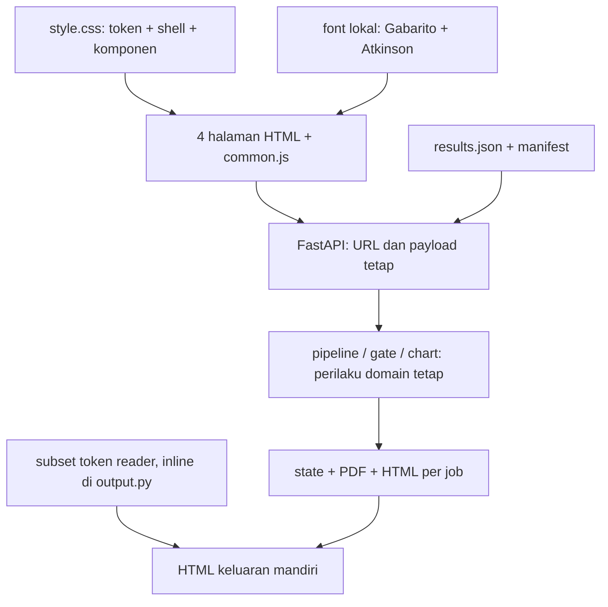

> Catatan historis sebelum implementasi cream. Status terkini dan hasil uji ada pada `tasks/implementation-cream.md` (relatif root Prototype). Temuan lama perlu dibaca sesuai versi sumbernya.

# Rencana perombakan UI/UX SIMAK dari template Sill

Tanggal: 23 Oktober 2026, WIB. Status: **rancangan untuk diskusi; implementasi aplikasi belum dimulai**.

## 1. Keputusan yang sudah ditetapkan

Permintaan: audit seluruh prototype, pahami template ZIP, kurasi desain, dan susun rencana desain serta teknis sebelum implementasi. Jawaban pengguna selama audit menetapkan **adaptasi visual template yang kuat, tetap aksesibel**, dengan **demo final lomba sebagai prioritas dan seluruh alur inti tetap berfungsi**.

Rekomendasi: ganti dunia visual kartu katalog hijau menjadi **komposisi editorial panel warna khas Sill**. Identitas baru tampak pada navigasi hitam, panel oranye, bidang violet/sage/taupe, tipografi judul tebal, sudut tegas, dan sela hitam. Bukti SIMAK—grafik, klaim, status gerbang, suara, dan keputusan ULD—mengisi panel tersebut. Area membaca dan meninjau memakai permukaan terang agar data tetap mudah diperiksa.

Ini perombakan komposisi, hierarki, dan interaksi; mengganti hijau menjadi oranye saja tidak cukup. Sebaliknya, struktur situs penitipan hewan tidak perlu dipindahkan ke aplikasi.

Skema untuk diskusi: [lihat gambar arah desain](design-direction.png) ([versi SVG](design-direction.svg)). Gambar ini menjelaskan komposisi Demo desktop dan Dengar mobile; bukan screenshot aplikasi yang sudah diimplementasikan, bukan ukuran viewport yang tersertifikasi, dan bukan bukti eksekusi gerbang. Nilai sumber grafik memakai syn043; 1.815 adalah contoh angka yang sengaja diubah dari 1.452 untuk menjelaskan interaksi.

Keputusan teknis utama:

- Pertahankan FastAPI + HTML/CSS/JavaScript statis. Tidak diperlukan React, Next.js, Tailwind, basis data baru, atau proses build frontend untuk mencapai hasil ini.
- Pertahankan empat halaman aplikasi dan HTML keluaran mandiri. Tidak menambah landing page pemasaran atau sistem mode presentasi terpisah pada tahap pertama.
- Arahkan perjalanan demo melalui **Dengar → Demo Gerbang → Remediasi/Tinjauan → Evaluasi**, tetapi pertahankan `/` sebagai halaman Remediasi dan semua URL lama.
- Adopsi bahasa visual dan beberapa struktur panel template; jangan menyalin seluruh HTML, CSS global, animasi, dan formulirnya.
- Jaga kontrak fail-closed dan pembeda antara hasil otomatis, keputusan manusia, penanda ditahan, serta hasil evaluasi tersimpan.
- Jadikan validitas status dan keselamatan penyimpanan keputusan sebagai bagian dari pekerjaan UI yang menyentuh alur tersebut, bukan pekerjaan susulan yang terlupakan.

## 2. Dasar audit dan tingkat kepastian

### 2.1 Materi yang diperiksa

| Materi | Peran |
|---|---|
| `web/index.html`, `demo.html`, `dengar.html`, `evaluasi.html` | Alur, markup, rendering, JavaScript per halaman |
| `web/style.css`, `fonts.css`, `common.js` | Shell, token, status, klaim, suara, perintah suara |
| `app.py`, `simak/pipeline.py`, `simak/output.py`, `simak/listen.py` | Batas API, keputusan ULD, keluaran mandiri, transkrip |
| `PRODUCT.md`, `DESIGN.md`, `README.md` | Konteks produk dan desain incumbent; perlu diperiksa terhadap kode terkini |
| `INSPEKSI_ARSITEKTUR.md` | Temuan terdahulu, dibedakan dari pengujian baru |
| `eval/results.json`, `data/synth/charts.json` | Sumber hasil dan contoh; bukan hasil eksperimen baru dalam audit ini |
| Template `index.html`, README, CREDITS, LICENSE, preview desktop/phone | Struktur desain, dependensi, aset, dan ketentuan atribusi yang tercantum |

Arsip sumber: `C:\Users\Faiz Iqbal\Downloads\pet-boarding-website-template-main.zip` (3.086.164 byte). SHA-256: `83462dbeb67f42a417f2b2ef622ab0dede3e5deecaf25f42e203f53c99f7c794`.

Salinan referensi berada di `reference/pet-template/`. `AGENTS.md` di dalam arsip diarsipkan sebagai **`ARCHIVE-INSTRUCTIONS-NOT-APPLICABLE.txt`** agar tidak menjadi aturan proyek. Pernyataan seperti mempertahankan 12 jendela, empat aturan, ID section, dan prompt penggantian bisnis adalah instruksi untuk situs asal, **bukan instruksi pengguna bagi SIMAK**. Kode/form dummy juga bukan otorisasi menghubungkan layanan eksternal.

### 2.2 Bukti tampilan saat ini

Inspeksi browser lokal dilakukan pada aplikasi yang sudah berjalan di `http://127.0.0.1:8000`. Capture utama: **1440×900** dan **390×844**, masing-masing untuk lima permukaan. Screenshot penuh lebih tinggi dari viewport; ukuran nama desktop/mobile merujuk lebar/tinggi viewport saat pengambilan.

| Permukaan | Desktop | Mobile |
|---|---|---|
| Remediasi, awal | [Screenshot](evidence/current-remediasi-desktop.png) | [Screenshot](evidence/current-remediasi-mobile.png) |
| Demo Gerbang, awal | [Screenshot](evidence/current-demo-desktop.png) | [Screenshot](evidence/current-demo-mobile.png) |
| Dengar, hasil dokumen yang sudah tersedia | [Screenshot](evidence/current-dengar-desktop.png) | [Screenshot](evidence/current-dengar-mobile.png) |
| Evaluasi tersimpan | [Screenshot](evidence/current-evaluasi-desktop.png) | [Screenshot](evidence/current-evaluasi-mobile.png) |
| HTML keluaran dokumen yang sudah tersedia | [Screenshot](evidence/current-output-desktop.png) | [Screenshot](evidence/current-output-mobile.png) |

Capture Dengar/keluaran memakai job `d9bf7c1454`; ID ini bukti sesi, bukan fixture yang boleh diandalkan implementasi mendatang. Tangkapan `.impeccable/review` yang lebih lama tidak mewakili seluruh navigasi dan fitur Dengar terbaru.

Pengukuran DOM utama pada 390×844: lebar dokumen empat halaman aplikasi = 390 px, tidak ada overflow horizontal tingkat halaman pada state yang diamati. Namun awal `main` Remediasi berada di sekitar y=239 px dan tombol **Proses PDF** di y=1.258 px. Pada Demo Gerbang, **Jalankan** berada di y=723 px. Ini bukti bahwa responsif secara lebar belum berarti efektif secara prioritas tindakan. Rincian: [mobile-measurements.json](evidence/mobile-measurements.json).

### 2.3 Batas klaim

- Penilaian desain dan teknis dibuat terpisah; lihat [design-assessment.md](design-assessment.md) dan [technical-assessment.md](technical-assessment.md).
- Assessment desain memberi **20/36 (55,6%)** pada sembilan heuristik yang dinilai; pemulihan galat tidak diberi skor karena belum diuji langsung. Assessment teknis memberi **12/20 sementara** berdasarkan sumber dan baseline desktop. Keduanya penilaian diagnostik kontekstual, bukan skor performa terukur atau kepatuhan WCAG.
- Launcher/context dan detector otomatis Impeccable dicoba, tetapi engine tidak tersedia dan unduhan terhambat. Log/status ada di `evidence/detector-*`. Tidak ada skor detector atau overlay yang dianggap lulus.
- Screenshot dan inspeksi DOM tidak membuktikan kepatuhan WCAG. Audit ini belum mencakup NVDA, perangkat sentuh fisik, seluruh state gangguan jaringan, uji beban, atau variasi peramban lengkap.
- Pemutaran audio sebenarnya dan kualitas suara bukan hasil yang dinyatakan sudah lulus pada audit utama. Tampilan Dengar adalah simulasi transkrip, bukan rekaman NVDA.
- Data evaluasi dibaca, bukan dikalibrasi atau dijalankan ulang. Angka di bawah harus selalu terikat sumber/run/dataset yang sama.

## 3. Membaca template: apa yang membuat desainnya kuat

Template bernama Sill dari 8B merupakan situs satu halaman, sekitar 96 KB HTML sumber dalam ZIP. Struktur CSS, JavaScript, teks, dan referensi aset ada di satu file. ZIP menyertakan preview, bukan seluruh aset runtime: foto dan font masih merujuk jaringan eksternal.

### 3.1 Tata bahasa visual

1. **Hitam adalah struktur.** Warna `#0b0a0a` menjadi latar dan sela antarpanel, bukan sekadar warna tulisan.
2. **Panel besar memiliki tugas berbeda.** Headline oranye, penjelasan violet, panel tindakan taupe, informasi maroon, foto tinggi dengan caption mauve.
3. **Komposisi asimetris dengan alignment yang disiplin.** Grid dasar 12 kolom membuat panel berbagai ukuran tetap terasa satu sistem.
4. **Tipografi memberi identitas.** Gabarito sangat tebal dan rapat untuk judul, Rethink Sans untuk isi, Playwrite untuk surat. Ukuran judul besar bukan alasan memperbesar seluruh antarmuka.
5. **Bentuk dan potongan gambar menjadi narasi.** Jendela, susunan tangga, panel bentuk kamar, dan komposisi foto memberi karakter.
6. **Motion menghubungkan section.** GSAP/ScrollTrigger/SplitText dan Lenis mengelola reveal, pin, parallax, serta perpindahan panel. Ini cocok untuk cerita tempat; tidak otomatis cocok untuk alat kerja.
7. **Mobile dikomposisikan ulang.** Header dan panel berganti urutan/skala, bukan sekadar desktop yang dikecilkan.

### 3.2 Kurasi seluruh bagian template

| Bagian asal | Keputusan | Adaptasi SIMAK | Alasan/batas |
|---|---|---|---|
| Navigasi hitam + wordmark + CTA | Ambil dan ubah | Empat tautan aplikasi, indikator halaman aktif, akses tindakan dokumen | Jangan auto-hide saat scroll pada alat kerja |
| Hero panel asimetris | Ambil kuat | Judul masalah/aksi, grafik atau cuplikan materi, tindakan nyata | Tidak mengambil dua layar tinggi yang menunda demo |
| Fasad 12 jendela | Ambil idenya saja | Kelompok bukti/elemen dokumen bila datanya ada | Jangan membuat 12 slot kosong demi aturan template |
| Tiga tipe kamar | Ubah | Perbandingan B0/B1/D atau tiga langkah remediasi yang benar | Bukan kartu fitur generik berisi janji |
| Surat/testimoni | Buang konten; ubah prinsip narasi | Cuplikan asli vs hasil SIMAK dari satu dokumen | Jangan menciptakan testimoni mahasiswa |
| Jadwal horizontal enam waktu | Ubah besar | Langkah proses vertikal/horizontal biasa sesuai lebar | Tanpa pinned horizontal scrolling atau waktu proses palsu |
| Empat staf/portraits | Tidak dipakai | Kredit IRIS secukupnya; tidak perlu halaman tim baru | Foto orang/hewan tidak menjelaskan mekanisme |
| Courtyard foto enam pane | Tidak dipindahkan literal | Bila dibutuhkan, fokus klaim → sel tabel sebagai momen visual | Jangan memecah grafik sehingga sulit dibaca |
| Tangga first visit | Ambil struktur informasi | Pilih PDF → proses → tinjau → baca/dengar | Urutan DOM tetap linear, bukan tangga sulit fokus |
| Empat house rules | Ubah | Batas produk: terverifikasi, ditahan, ditinjau ULD, keterbatasan | Jumlah mengikuti isi; tidak wajib empat |
| FAQ native details | Ambil pola | Definisi B0/B1/B2/D, cF/cδ/cA/cL, dukungan PDF, batas suara | Bantuan dekat tugas; detail tetap dapat dibuka keyboard |
| Booking form | Buang | Pertahankan form unggah/API SIMAK asli | Form template hanya menampilkan sukses lokal, tidak mengirim |
| Footer wordmark besar | Ambil terbatas | Kredit sumber, tim, status prototype | Tidak menghabiskan layar alat kerja dengan footer raksasa |
| Handwritten font/doodle | Sangat dibatasi | Boleh ornamen kecil noninformatif pada pembuka jika bermanfaat | Tidak untuk angka, label status, deskripsi, atau tombol |
| Foto Unsplash | Buang untuk UI inti | Gunakan grafik, halaman PDF sintetis, tabel, dan hasil asli | Bukti produk lebih relevan dan tersedia lokal |
| GSAP + Lenis | Jangan adopsi pada tahap pertama | CSS transition sederhana, opsional animasi status singkat | Menghindari dependensi/CDN dan perilaku scroll baru |

Template sudah memiliki skip link/semantik, beberapa label, native details, dan cabang reduced-motion. Karena itu tidak tepat menyebutnya sepenuhnya tidak aksesibel. Namun kebutuhan aplikasi SIMAK lebih ketat: menu, status pekerjaan, perubahan dinamis, fokus, dan sumber bukti perlu ditangani sesuai alur aplikasi.

## 4. Audit prototype: yang dipertahankan dan yang diubah

### 4.1 Fondasi yang bernilai

- Bahasa Indonesia, nama dan istilah domain, empat alur yang sudah bekerja.
- Font Atkinson Hyperlegible lokal, skip link, sebagian besar label form, heading/landmark, fokus terlihat, dan status live.
- Angka/klaim bisa dilacak ke baris sumber; ini ciri khas yang harus menjadi pusat desain baru.
- Demo B2 vs D, empat jenis injeksi, hasil evaluasi faktual beserta interval dan batasnya.
- Antrean elemen termasuk figur vektor dan rumus yang belum dapat diverifikasi; tetap ditahan.
- HTML keluaran mandiri dengan font/gambar tertanam, mode dengar, preferensi terang/gelap.
- Stack sederhana yang sudah cocok untuk demo lokal. Tidak ada alasan desain yang memerlukan migrasi framework.

### 4.2 Daftar temuan yang diprioritaskan

`Teramati` = terlihat pada browser/capture sekarang; `kode` = diverifikasi dari implementasi; `dugaan` = risiko yang perlu pengujian terarah. Tidak ada P0 yang terbukti pada audit ini.

| ID | Prioritas | Bukti/lokasi | Dampak | Rencana |
|---|---|---|---|---|
| UX-01 | P1 | Remediasi mobile: Proses PDF y≈1.258; contoh mendahului upload | Aksi utama tertutup navigasi, prosa, dan daftar contoh | Upload lebih dulu pada mobile; ringkas header; contoh menjadi pilihan sekunder yang jelas |
| UX-02 | P1 | Demo awal: sumber grafik baru ada di bagian bawah dan setelah run | Juri harus menahan penjelasan tanpa melihat objek | Grafik/identitas sumber berdampingan dengan kontrol dan hasil di desktop |
| UX-03 | P1 | `dengar.html`: label hero menyebut pembaca layar; penjelasan simulasi di akhir | Simulasi berpotensi dianggap hasil uji NVDA | Label "Simulasi pembacaan" dekat judul, angka, dan kontrol |
| UX-04 | P1 | Evaluasi membedakan G1 dan G1 ketat, tetapi verdict besar lebih menonjol | "Lulus" dapat dibaca sebagai seluruh aksesibilitas sudah selesai | Dua status eksplisit: validasi struktur vs kelengkapan deskripsi; denominator selalu terlihat |
| UX-05 | P1 | Remediasi `start/poll`: JID global, timer berulang, sampel tetap aktif | Respons/poll lama dapat menggeser sesi aktif | Ikat polling ke job pemiliknya, batalkan timer/request lama, cegah start paralel dari UI |
| UX-06 | P1 | `fetch` tanpa catch/finally di jalur utama | Gangguan jaringan dapat meninggalkan tombol sibuk atau layar kosong | Satu jalur galat/pemulihan per operasi, pertahankan input/draf |
| UX-07 | P1 | Tinjauan: Setujui dan Simpan perubahan & setujui sama-sama menonjol | Pengguna tidak yakin apakah edit tersimpan atau status berbeda | Satu aksi primer dengan intent eksplisit dan pemetaan setujui/ubah berdasarkan perubahan |
| UX-08 | P1 | `detail()` mengganti seluruh HTML editor ketika elemen dipilih ulang | Draf edit dapat hilang tanpa sadar saat navigasi/filter | Peringatan draf belum disimpan; pertahankan draf per elemen selama sesi bila diperlukan |
| UX-09 | P1 | `pipeline.review/save` tanpa transaksi/lock; temuan inspeksi arsitektur | Dua keputusan dapat menimpa satu sama lain | Perbaiki konsistensi save pada slice tinjauan; uji request bersamaan |
| UX-10 | P1 | Teks UI menjanjikan hapus setelah 6 jam; cleanup hanya saat startup | Janji produk tidak cocok dengan perilaku retensi | Tahap demo: teks jujur + Hapus sesi; TTL berkala hanya bila benar-benar diimplementasikan |
| UX-11 | P2 | `renderRail`: wordmark menuju demo, `/` menuju remediasi; job tak dibawa lintas halaman | Orientasi dan kesinambungan dokumen lemah | Wordmark menuju `/`; tautan kontekstual membawa job; link tanpa konteks punya state jelas |
| UX-12 | P2 | Semua kartu memakai rule merah, cap miring, garis buku | Sinyal galat dan status bersaing dengan dekorasi | Hitam untuk struktur; merah hanya galat/destruktif; status teks+ikon tanpa cap dekoratif |
| UX-13 | P2 | Default contoh bernama materi_01, dst. | Juri/operator harus mengingat contoh yang tepat | Label deskriptif dari metadata nyata; jangan mengarang judul/jumlah halaman |
| UX-14 | P2 | Antrean berada setelah ringkasan panjang | Tugas ULD memerlukan scroll sebelum mulai | Pada state hasil: ringkasan singkat + jump ke antrean; detail audit dalam disclosure |
| UX-15 | P2 | Rail 272 px; pada mobile nav+suara menghabiskan tinggi | Ruang pembuktian sedikit, terutama pada proyektor 1366×768 | Header horizontal kompak, empat nav tampak tanpa menu kompleks bila muat |
| UX-16 | P2 | Variasi gaya lokal dalam `<style>` dan CSS Python terpisah | Redesign rawan tidak menjangkau HTML keluaran | Peta caller lengkap; subset token keluaran ikut diperbarui dan diuji |
| UX-17 | P2 | Loader `.status.busy` tetap spin pada reduced-motion | Indikator gerak belum seluruhnya mengikuti preferensi | Ganti dengan label/progres statis ketika reduced-motion; jangan hilangkan feedback |
| UX-18 | P2 | Evaluasi mobile menyembunyikan kolom k/n via `.kn` | Persentase dapat kehilangan jumlah sampel di beberapa baris | k/n tampil ulang secara inline; interval tetap tersedia, jangan dibuang demi muat |
| UX-19 | P2 | `app.py` belum membatasi byte/halaman unggah, error internal bisa tampil | UI baru dapat menjanjikan kapasitas yang belum ada | Tampilkan batas hanya jika backend menegakkannya; sanitasi galat untuk pengguna |
| UX-20 | P3 | Favicon/kredit/metadata belum satu paket | Demo tampak belum selesai, terutama saat tab berpindah | Ikon SIMAK lokal, judul route konsisten, kredit template bila dipakai |
| UX-21 | P1 | `Player.render()` mengganti kontrol dengan `innerHTML`; list/detail tinjauan juga dirender ulang | Fokus keyboard dapat terlepas dan pengguna kehilangan lokasi; risiko sumber, belum dibuktikan dengan AT | Pertahankan node kontrol pemutar, kelola fokus seleksi/sukses, uji keyboard setelah update |
| UX-22 | P1 | Hapus sesi langsung DELETE lalu reload tanpa memeriksa hasil | Salah klik berisiko menghapus dokumen/keputusan, request gagal dapat tampak berhasil | Konfirmasi bernama sesi, cek hasil DELETE, recovery tanpa reload palsu |

UX-09/19 menyentuh backend karena langsung memengaruhi janji dan keamanan alur UI. Ini bukan alasan memperluas pekerjaan menjadi platform produksi multiuser.

### 4.3 Persona untuk menguji keputusan desain

| Persona | Tugas/konteks yang didukung bukti proyek | Yang harus terasa mudah |
|---|---|---|
| Juri yang baru mengenal SIMAK | Menilai mekanisme dalam demo ±15 menit di proyektor | Mengerti satu grafik yang sama, kesalahan yang sama, dan mengapa status berbeda |
| Operator ULD | Memilih dokumen, memahami alasan tahan, memutuskan teks alt | Membandingkan sumber dan draf tanpa bolak-balik layar; tahu keputusan sudah tersimpan |
| Pembaca dengan keyboard/pembaca layar | Mengakses keluaran kuliah dan mode dengar | Urutan baca benar, kontrol berlabel, status diumumkan, tidak bergantung warna/mouse |

Persona adalah alat telaah berbasis konteks, bukan peserta penelitian yang telah diwawancarai. Klaim keterujian oleh mahasiswa tunanetra tidak boleh ditambahkan.

## 5. Arah desain yang direkomendasikan

### 5.1 Prinsip komposisi

**Gagasan utama: materi yang semula tidak tersampaikan menjadi bukti yang dapat diperiksa dan didengar.**

Panel khas Sill tetap dominan pada pembuka dan rangkuman hasil. Saat masuk ke pemeriksaan angka atau penyuntingan alt, identitas muncul lewat header, garis hitam, ukuran judul, dan blok status; isi panjang tetap di permukaan paper/putih. Satu halaman tidak perlu menyalakan semua warna template sekaligus.

Tiga intensitas desain dibedakan berdasarkan tugas:

| Permukaan | Mode | Intensitas |
|---|---|---|
| Dengar pembuka + Demo Gerbang | Operate dengan pembuktian untuk juri | Paling ekspresif; panel berwarna dan angka besar, kontrol langsung tersedia |
| Remediasi awal + Evaluasi ringkas | Operate/Read | Panel asimetris terarah, data ringkas, detail bertahap |
| Editor ULD + tabel bukti + HTML mahasiswa | Operate/Read | Tenang, ruang baca luas, status kuat; hindari latar jenuh untuk paragraf panjang |

Pilihan alternatif yang dipertimbangkan: (a) menyalin gaya landing page Sill hampir literal, sangat kuat secara visual tetapi menunda tugas; (b) mengambil palet saja, murah tetapi terlalu sedikit memenuhi niat perombakan. Rekomendasi berada pada **adaptasi kuat komposisi dan identitas**, bukan kompromi warna kecil.

### 5.2 Navigasi dan kontinuitas

- Header hitam, tinggi sasaran 72–84 px desktop; wordmark SIMAK kiri, empat tujuan jelas, halaman aktif memakai underline/shape dan `aria-current`.
- Urutan navigasi untuk demo: **Dengar, Demo Gerbang, Remediasi, Evaluasi**. Nama domain tetap dipertahankan; boleh label panjang di judul halaman.
- Wordmark menuju Remediasi `/`, agar perilaku home konsisten. Story demo dijelaskan dalam panduan presentasi, bukan dengan mengubah home secara diam-diam.
- Header mobile memakai dua baris ringkas atau nav dua kali dua yang cukup disentuh. Empat tujuan tidak memerlukan drawer overlay baru.
- Perintah suara tetap tersedia melalui disclosure/tombol yang berlabel; tidak mengambil satu blok kosong besar di atas pekerjaan. Perubahan label wajib tetap cocok dengan resolver perintah suara.
- Konteks aktif: query `?job=<id>` pada tautan Remediasi↔Dengar; query `?grafik=<id>` di Demo dipertahankan. `sessionStorage` hanya cadangan ID sesi, bukan sumber data utama atau tempat PDF/draf sensitif permanen. State kanonik tetap API.
- Job hilang/kedaluwarsa memberi pesan khusus dan kembali ke pilih dokumen. Hapus sesi membersihkan konteks lokal terkait.

## 6. Rancangan per halaman dan interaksi

### 6.1 Remediasi: sebelum ada dokumen

Tujuan: satu tindakan pertama yang jelas. Judul usulan: **"Materi kuliah, lebih mudah diakses."** Ini pernyataan tujuan, bukan klaim hasil setiap PDF.

Desktop, grid 12 kolom:

```text
HEADER HITAM: SIMAK | Dengar | Demo Gerbang | Remediasi aktif | Evaluasi
┌──────────────────────────── 7 kolom ─────────────────┬──── 5 kolom ────┐
│ ORANYE: judul + 2 baris penjelasan                   │ PAPER: Unggah PDF│
│ Deskripsi diverifikasi atau ditahan untuk ULD.      │ Pilih berkas     │
│ Tautan: Lihat cara gerbang bekerja                  │ Proses PDF       │
├──────── VIOLET: contoh terpilih ─────┬───────────────┤ dukungan/batas   │
│ Gunakan dokumen contoh             │ SAGE: alur    │ yang faktual     │
│ Judul nyata + asal sintetis         │ 1–2–3–4      │                 │
└────────────────────────────────────┴───────────────┴─────────────────┘
```

Mobile: judul pendek → form upload/tombol → contoh → bantuan; contoh tidak boleh mendorong aksi utama sejauh y=1.258 lagi. Sasaran pada 390×844: kontrol pilih file dan aksi pemrosesan terlihat tanpa harus melewati daftar enam contoh. Nama file panjang membungkus; metadata tidak memotong teks penting.

Tidak perlu drag-and-drop baru. Input file native yang sudah ada cukup; area visual besar tetap memiliki label yang terhubung ke input dan bisa digunakan keyboard. Validasi file, batas, dan galat harus berdasarkan kemampuan backend.

### 6.2 Remediasi: sedang memproses

- Tampilkan judul berkas dan tahapan yang benar-benar dilaporkan server: menunggu/struktur/elemen/perakitan/validasi/selesai sesuai enum yang diverifikasi saat implementasi.
- Tanpa persentase atau hitungan mundur fiktif bila API tidak menyediakannya.
- Form/semua tombol sampel dinonaktifkan selama satu start aktif; tombol pembatalan hanya ditawarkan bila backend benar-benar mendukung pembatalan. "Pilih dokumen lain" setelah job selesai/gagal berbeda dari membatalkan thread server.
- Pengguna tetap boleh membaca penjelasan proses dan berpindah halaman; polling lokal dibersihkan, tetapi job server tidak diklaim berhenti.
- Gangguan koneksi mempertahankan ID job dan menawarkan **Coba cek lagi**; jangan otomatis membuat job kedua.

### 6.3 Remediasi: hasil dan tinjauan ULD

Urutan: nama dokumen → ringkasan operasional → antrean/elemen → detail audit → keluaran. Tautan keluaran tetap mudah dijangkau, disertai kondisi dokumen.

```text
KONTEKS DOKUMEN: nama, halaman, status proses, Dengar, HTML, PDF
SAGE: terbit otomatis | AMBER: perlu tinjauan | PAPER: keputusan ULD
Status struktur PDF dan kelengkapan deskripsi dinyatakan terpisah.
┌──── daftar 28–32% ────┬──────── ruang tinjauan 68–72% ────────────┐
│ Antrean / Semua       │ Elemen + halaman + status + alasan tahan  │
│ Thumbnail + nama      │ Pratinjau sumber yang cukup besar          │
│ Status + halaman      │ Deskripsi/draf; klaim dapat dilacak        │
│ Elemen dipilih jelas  │ Bukti T1/T2 (disclosure)                  │
│                      │ Editor alt + aksi Simpan dan setujui     │
└──────────────────────┴───────────────────────────────────────────┘
Audit B0→B1→D (details) | riwayat keputusan | Hapus sesi
```

Aturan keputusan:

- Satu primer: **Setujui deskripsi** bila tidak diubah, atau **Simpan dan setujui** bila dirty. Panggil `aksi=setujui`/`aksi=ubah` agar riwayat domain tetap bermakna. Backend saat ini menerima `alt` pada setujui; perbedaan utamanya status, bukan asumsi bahwa teks diabaikan.
- **Tandai dekoratif** dan **Tolak** sekunder, penjelasan akibatnya jelas. Tidak menganggap Tolak = Hapus elemen.
- Editor mempertahankan draf pada galat. Pindah elemen/filter dengan draf dirty meminta pilihan tetap/edit dibuang; jangan menyimpan ke server tanpa tindakan pengguna.
- Tombol dinonaktifkan saat menyimpan; status "Menyimpan keputusan dan merakit ulang keluaran…". Sukses hanya setelah server selesai dan state terbaru diperoleh.
- Setelah sukses, antrean berubah dan fokus menuju pesan/elemen berikut yang logis; riwayat elemen yang baru diputus tetap dapat diakses lewat Semua.
- Status manusia tidak diberi label "terverifikasi otomatis". Tinjauan manusia dan gerbang otomatis adalah dua provenance berbeda.
- Pratinjau figur vektor, rumus, dan halaman campuran tetap mengungkap batas pemetaan PDF/HTML yang nyata; jangan menjanjikan keputusan tertanam ke kedua keluaran bila pipeline hanya menerapkan ke HTML.
- Mobile: daftar pilihan → elemen dipilih → editor; gunakan jump link/scroll focus yang terukur. Hindari dua area scroll vertikal tinggi sekaligus.

### 6.4 Demo Gerbang: layar pembuktian utama

Tujuan juri: melihat sumber yang sama, dua keluaran, dan efek injeksi tanpa berpindah konteks.

Desktop: header kompak oranye 24–40% area atas untuk judul dan kontrol; grafik asli dan identitas contoh segera terlihat; dua panel hasil **setara lebarnya**. Panel warna menandai identitas B2/D; status memiliki komponen sendiri sehingga warna identitas tidak mengesankan lulus/gagal.

```text
ORANYE: Satu grafik. Dua cara menerbitkan deskripsi.
Pilih grafik [syn043…] [Jalankan] [Kembalikan] status
┌──── grafik asli 4/12 ────┬──────── kontrol injeksi / konteks 8/12 ───┐
│ Grafik utuh, tidak crop  │ Ubah angka / Tukar label / Selisih / Tren │
│ Caption+dataset         │ Instruksi singkat + perubahan terakhir    │
└────────────────────────┴───────────────────────────────────────────┘
┌──────── VIOLET: VLM langsung / B2 ──────┬──────── SAGE: SIMAK / D ───┐
│ Status aktual, teks, angka ditandai     │ Status aktual, teks/klaim  │
│ Evaluasi angka tidak mencegah terbit B2 │ alasan + pemeriksaan      │
└────────────────────────────────────────┴───────────────────────────┘
Tabel sumber yang disorot + T1/T2 (details) | papan skor sesi
```

- B2 dapat kebetulan cocok; jangan selalu menggambarkannya salah sebelum hasil nyata diketahui.
- Sebelum run: preview sumber boleh dimuat dari `/api/grafik/<id>.png`; tidak ada verdict terverifikasi palsu.
- Kontrol suntik aktif hanya setelah baseline siap; picker juga dikunci selama request agar CID, BASE, grafik, dan teks tetap satu konteks.
- Saat memilih grafik lain, baseline lama harus jelas invalid/tidak lagi berlaku sampai run selesai. Respons terlambat tidak boleh menimpa grafik baru.
- Injeksi menampilkan jenis perubahan, status hasil, dan alasan. Jangan mengganti grafik masukan seolah data aslinya yang berubah bila yang dimutasi adalah deskripsi.
- Penjelasan cF/cδ/cA/cL tampil sebagai nama singkat + bantuan yang dapat dibuka, bukan deretan simbol wajib dihafal.
- Reset mengembalikan baseline tanpa mengarang ulang API; jelaskan apakah skor sesi dipertahankan. Rekomendasi: **Kembalikan deskripsi** tidak mereset skor, sama seperti perilaku saat ini; **Jalankan** membuat sesi skor baru dan dilabeli demikian.
- Mobile: sumber → tindakan → dua hasil berurutan dengan judul eksplisit, ringkasan verdict berdekatan agar perbandingan tidak menuntut hafalan. Tidak menambah tabs yang menyembunyikan salah satu hasil pada tahap pertama.
- Agar grafik dan dua verdict muat pada proyektor, teks penuh tidak harus seluruhnya terbuka: tampilkan klaim yang dipilih dan ringkasan keputusan pada lapis pertama, lalu disclosure **Baca deskripsi lengkap** untuk setiap sisi. Jangan memotong atau menghilangkan deskripsi dari akses keyboard/pembaca layar.

### 6.5 Dengar: bukti manfaat bagi pembaca

Judul usulan: **"Satu materi. Lebih banyak yang tersampaikan."** Subjudul langsung: **"Simulasi pembacaan PDF asli dan hasil SIMAK; bukan rekaman NVDA."**

- Panel oranye memuat judul ringkas; grafik/ilustrasi dokumen asli di sisi lain.
- Dua panel besar: **PDF asli — simulasi** dan **Hasil SIMAK — urutan baca keluaran**; masing-masing tombol dengar dan teks yang sama-sama tersedia.
- Pertahankan perbandingan satu grafik yang sudah ada, tetapi ukur panjang deskripsi. Teks penuh dapat dibuka; cuplikan tidak boleh menghilangkan status ditahan atau mengubah fakta.
- Tampilkan suara dan kecepatan dekat kontrol audio, status pemutaran terbaca, serta berhenti/jeda yang jelas. Hanya satu player bersuara pada satu waktu, termasuk tombol momen, transkrip, dan perintah suara.
- Pilihan suara manusia hanya muncul bila API mendukung; keterangan pengiriman teks ke layanan tersebut tersedia saat opsi dipilih. Tidak memutar/mengirim otomatis sebagai syarat membuka halaman.
- Bila tidak ada suara Indonesia atau Web Speech, teks tetap dapat dipakai; tampilkan pemulihan tanpa menjanjikan voice tertentu tersedia di semua perangkat.
- Transkrip lengkap tetap semantik dan keyboard operable. Fokus pengguna tidak diseret oleh pembaruan audio; highlight mengikuti pembacaan, scroll otomatis menghormati reduced-motion.
- Label angka: yang dihitung adalah perbandingan dari dokumen ini, bukan peningkatan yang telah dibuktikan oleh studi pengguna.
- Pergantian dokumen menghentikan player dan membuang hasil lama yang tidak lagi sesuai. Bila memilih job yang sudah selesai, jangan memproses ulang hanya untuk mendengarnya.

### 6.6 Evaluasi: bukti yang mudah dibaca dan tidak berlebihan

Lapisan pertama berupa panel ringkas; lapisan kedua tabel audit; lapisan ketiga metode/manifes. Angka harus terisi dari JSON yang ada, bukan copy statis dalam HTML.

Panel ringkas yang diusulkan berdasarkan run tersimpan saat audit:

- **440/440** klaim terbit cocok dengan tabel acuan, pada set uji sintetis; bukan jumlah dokumen/mahasiswa.
- **137/138** injeksi tertahan; satu kegagalan tidak disembunyikan.
- **20/60** grafik membutuhkan tinjauan; tampilkan biaya otomatisasi, bukan hanya akurasi.
- **G1 ketat 0/4** pada dokumen sintetis: penanda tahan belum dihitung sebagai deskripsi bermakna. Letakkan dekat G1 biasa, bukan sebagai catatan yang tercecer.

Ketentuan penyajian:

- B2 17 angka keliru pada 7/60 grafik adalah temuan pemeriksa pola yang diaudit, bukan generalisasi universal semua VLM.
- G4 Q=1,00 menjelaskan rasio terhadap konteks tabel dan penjawab model; bukan bukti kesetaraan pengalaman mahasiswa.
- G6 ringan dipisahkan dari set sintetis: 6 PDF nyata, veraPDF penuh D 2/6, beban tinjauan 18/18; jangan dipasarkan sebagai validasi penuh.
- Tampilkan G2/G5/G6 penuh/G7 sebagai belum dijalankan sesuai sumber yang ditetapkan, bukan menciptakan kartu hijau.
- Perbandingan 440/440 vs 17 memakai unit berbeda: judul/unit wajib eksplisit; jangan dijadikan bar chart komparatif seolah metriknya sama.
- Persentase, k/n, IK95%, dataset, dan waktu run dapat diakses di mobile. Hindari menyembunyikan denominator; bungkus metadata ke baris kedua.
- Tanggal/waktu run mengikuti nilai manifes dan zona yang diketahui. Jangan menempelkan WIB ke timestamp sumber yang tidak mendeklarasikan zona.

### 6.7 HTML keluaran mahasiswa

Ini permukaan Read. Jangan memindahkan seluruh kolase Sill ke materi kuliah.

- Warisan visual: wordmark/header hitam atau aksen oranye, tipografi tegas, status konsisten; teks materi tetap permukaan terang atau dark mode yang sudah didukung.
- Pertahankan `<html lang="id">`, heading, tabel ber-caption/header, alt, `data-say`, skip link, navigasi bagian, dan gambar tertanam.
- Perbarui subset token CSS di `simak/output.py`; HTML unduhan tidak boleh memerlukan `style.css`, `common.js`, font CDN, atau server agar teks/gambar/voice browser dapat dipakai.
- Tombol dengar dapat sticky, tetapi jangan menutup heading/fokus atau memakai 25–35% viewport mobile. Kontrol tambahan bisa disclosure; Putar/Jeda dan lokasi pembacaan selalu jelas.
- Status terbit otomatis, disetujui, diubah, ditahan, ditolak, dekoratif tetap benar. Draft ditahan tidak tampil seolah final.
- Semua perubahan generator diverifikasi lewat keluaran yang baru dibuat di fixture temporer. HTML lama pada `work/` tidak berubah sendiri hanya karena generator diedit; jangan merakit ulang dokumen pengguna secara massal sebagai efek redesign.
- Dark mode keluaran ikut diuji; UI operator tetap light-content pada tahap pertama. Header hitam bukan implementasi dark mode aplikasi.

## 7. Sistem visual usulan

### 7.1 Token warna dan penggunaan

| Token usulan | Nilai | Pemakaian |
|---|---|---|
| `--ink` / `--frame` | `#0b0a0a` | Header, sela panel, teks utama, struktur |
| `--paper` | `#f4f1ee` | Area baca, isi tabel/editor, teks di violet |
| `--white` | `#ffffff` | Dokumen/grafik/surface kontrol tertentu |
| `--brand` | `#cf6224` | Panel judul, CTA utama tertentu dengan teks hitam |
| `--violet` | `#5a3cd4` | Identitas panel, bukan status ditahan otomatis |
| `--sage` | `#80a89b` | Panel manfaat/rangkuman dengan teks hitam |
| `--taupe` | `#bca59d` | Konteks/penjelasan sekunder dengan teks hitam |
| `--muted` | `#514c49` | Teks sekunder pada paper |
| `--verified` / `--verified-bg` | `#185c3a` / `#e4f2e9` | Hasil lolos otomatis, teks+ikon+label |
| `--hold` / `--hold-bg` | `#624000` / `#fff0c2` | Ditahan/perlu tinjauan |
| `--error` / `--error-bg` | `#a51d2d` / `#fce6e8` | Galat, salah, destruktif |
| `--focus` | `#1457c5` | Fokus pada permukaan terang; gunakan outline terang ganda pada bidang gelap/jenuh |

Perhitungan sRGB lokal: hitam/oranye **5,11:1**, paper/violet **6,16:1**, hitam/sage **7,53:1**, hitam/taupe **8,48:1**. **Paper/oranye hanya 3,44:1**, sehingga tidak dipakai untuk teks normal. Pasangan semantik error/hold/verified terhadap latar masing-masing >6:1. Bukti: [proposed-contrast.json](evidence/proposed-contrast.json). Ini pemeriksaan pasangan token, bukan sertifikat seluruh state komponen.

Palet maroon/mauve/mustard template tidak semuanya dijadikan token wajib. Maroon mudah bersaing dengan galat, dan warna berlebih menambah beban identifikasi. Gunakan ketika ada tugas komposisi yang nyata.

### 7.2 Tipografi

- **Gabarito**, self-hosted, judul/angka demonstrasi/wordmark. Ini penghubung paling nyata dengan template. Gunakan bobot tebal yang tersedia, bukan faux bold.
- **Atkinson Hyperlegible Next**, tetap lokal, untuk deskripsi, tabel, editor, label, dan seluruh HTML mahasiswa.
- **Atkinson Hyperlegible Mono**, tetap lokal, hanya kode elemen, angka yang dilacak, dan nilai tabel bila memudahkan pembacaan. Aktifkan tabular nums.
- Rethink Sans dan handwriting tidak perlu ditambah pada tahap pertama: tiga keluarga tambahan menambah beban tanpa manfaat yang jelas pada pekerjaan SIMAK.
- Root tetap **18 px** pada aplikasi agar tidak mengecilkan ukuran baca incumbent. Token skala dijelaskan dalam rem yang sesuai: label 0,875rem≈15,75px, body 1rem≈18px, description 1–1,0625rem≈18–19,125px, section 1,5rem≈27px. Komentar CSS lama yang menyatakan 1rem=16px harus disesuaikan.
- Headline awal 48–72 px desktop, 32–40 px mobile; layar hasil/editor 28–40 px. Jangan membawa judul 116 px template ke semua halaman aplikasi.
- Body line-height 1,5–1,7; kolom baca sekitar 60–75 karakter. Headline 1–1,1 cukup untuk Bahasa Indonesia, tanpa line-height ekstrem yang memotong aksen.

### 7.3 Grid, bentuk, dan jarak

- Layout desktop 12 kolom; sela hitam 12–16 px, margin luar 16–24 px. Maksimum konten sekitar 1.600 px; lebar sangat besar tidak memperpanjang paragraf tanpa batas.
- Skala spasi: 4, 8, 12, 16, 24, 32, 48, 64 px.
- Panel utama 0–2 px radius; input/editor/control 2–4 px agar affordance jelas. Tanpa rounded pill besar sebagai motif default.
- Batas antarpanel berasal dari latar hitam dan gap; jangan menambahkan bayangan dan nested card untuk setiap baris.
- Gambar grafik selalu `object-fit:contain`; foto dekoratif tidak menggantikan grafik nyata.
- Fokus kontras ganda pada bidang jenuh; label status selalu teks+ikon. Warna panel identitas dan warna status menggunakan namespace/token berbeda.

### 7.4 Motion

- Transisi hover/focus/tekan sekitar 120–180 ms; pergantian status sekitar 160–240 ms, tanpa menghambat klik/fokus.
- Hasil tidak perlu datang dengan cap berputar, blur, atau stagger panjang. Penekanan boleh lewat border/highlight singkat pada lokasi perubahan.
- Reduced-motion: tampilkan hasil langsung dengan label status tetap lengkap. Spinner diganti tanda menunggu statis; tidak perlu menghentikan seluruh feedback.
- Tanpa Lenis, pin, parallax, scroll hijacking, autoplay, atau reveal yang membuat teks tak terbaca sebelum JavaScript berhasil.
- Bila kelak benar-benar membutuhkan GSAP untuk pembuka presentasi, jadikan pekerjaan opsional terpisah, lokal, dan progressive enhancement; inti UI tetap berjalan ketika library tidak ada.

## 8. Kontrak aksesibilitas, responsif, dan state

### 8.1 Aksesibilitas yang harus dibuktikan saat implementasi

| Area | Acceptance target |
|---|---|
| Keyboard | Seluruh unggah, run, inject, reset, pilih elemen, edit, simpan, filter, audio, details, dan unduh dapat dilakukan keyboard |
| Fokus | Terlihat di semua warna, urutan logis, tidak tertutup sticky header/player; fokus tidak hilang saat render dinamis |
| Status | Live region ringkas untuk progres/keputusan; jangan membacakan ulang seluruh editor/transkrip setiap pembaruan |
| Form | Label terhubung, dukungan file jelas, galat dekat sumber, draf tidak dihapus saat gagal |
| Kontras | Normal ≥4,5:1; teks besar ≥3:1; komponen/fokus yang relevan diperiksa terpisah |
| Ukuran target | Sasaran proyek ≥44×44 CSS px untuk kontrol utama; jangan mengklaim angka itu minimum universal WCAG AA |
| Reflow | 320 CSS px tanpa scroll dua arah tingkat halaman; tabel/grafik yang perlu dua dimensi boleh punya region scroll berlabel |
| Zoom | 200% teks dan 400% zoom diuji; perilaku 320 px tidak digantikan semata screenshot 390 px |
| Semantik | Satu h1, hirarki heading, nav/main, tombol native, caption/th, role/state yang benar |
| Warna | Lulus, ditahan, salah, disetujui, dan diubah dapat dipahami tanpa warna |
| Media | Tidak ada autoplay; suara fallback, teks lengkap, stop/jeda, reduced-motion |
| Pembaca layar | NVDA + Edge/Chrome target desktop yang tersedia; record hasil nyata sebelum klaim lulus |

WCAG 2.2 AA Target Size Minimum memakai 24 CSS px dengan pengecualian; 44 px dipilih sebagai standar kenyamanan proyek. Rujukan primer: [W3C target size](https://www.w3.org/WAI/WCAG22/Understanding/target-size-minimum.html), [contrast](https://www.w3.org/WAI/WCAG22/Understanding/contrast-minimum.html), [reflow](https://www.w3.org/WAI/WCAG22/Understanding/reflow.html). Reduced-motion mengikuti preferensi sistem melalui [fitur media CSS](https://developer.mozilla.org/en-US/docs/Web/CSS/@media/prefers-reduced-motion).

### 8.2 Matriks viewport

| Viewport | Alasan | Perilaku yang dituju |
|---|---|---|
| 1440×900 | Desktop audit saat ini | Dua hasil demo + sumber/kontrol mudah dipahami |
| 1366×768 | Laptop/proyektor | Run, identitas sumber, dan ringkasan verdict tidak tenggelam di prosa |
| 1024×768 | Tablet landscape/laptop kecil | Grid berkurang; editor tidak terlalu sempit |
| 768×1024 | Tablet portrait | Panel bertumpuk sesuai urutan tugas |
| 390×844 | Ponsel audit utama | Upload sebelum contoh; tidak ada rail tinggi |
| 320×568 | Reflow ekstrem | Tidak ada overflow tingkat halaman atau kontrol terpotong |

Breakpoint dipilih dari kebutuhan konten, bukan angka template yang harus dipertahankan. Usulan awal: 1200 untuk pengurangan grid, 900 untuk stack editor, 600 untuk nav/control wrapping. Konfirmasi dengan teks panjang sebelum dikunci.

### 8.3 State dan jalur pemulihan

| State | Pemicu | Tampilan | Tindakan aman berikutnya |
|---|---|---|---|
| Awal | Belum ada dokumen/run | Tujuan singkat, sumber/aksi jelas | Pilih file/contoh/run |
| Loading | Sampel/API/font belum siap | Struktur tetap stabil, status berlabel | Tunggu; retry jika gagal |
| Memproses | Job aktif | Nama dokumen + tahap server, tanpa persen palsu | Cek status lagi, lanjut membaca halaman |
| Kosong | Tidak ada antrean/hasil evaluasi/contoh tersedia | Sebab spesifik, bukan halaman kosong | Semua gambar/pilih dokumen/kembali |
| Parsial | Sebagian elemen ditahan, validator tidak tersedia | Bagian tersedia tetap ditampilkan; status tak diketahui bukan gagal palsu | Tinjau bagian terkait/lihat batas |
| Galat input | Bukan PDF/alt kosong/di luar batas nyata | Pesan dekat kontrol, fokus tepat | Perbaiki input tanpa kehilangan pilihan |
| Galat jaringan | Fetch gagal/server terputus | Status koneksi dan konteks job tetap | Retry pembacaan; hindari duplikasi mutasi |
| Galat simpan ambigu | Request simpan terputus setelah dikirim | "Status penyimpanan belum diketahui" | Baca state terbaru sebelum kirim ulang |
| Sukses | Proses/keputusan selesai | Ringkasan hasil dari respons/state baru | Tinjau berikutnya/dengar/unduh |
| Sesi hilang | Job 404/dihapus/kedaluwarsa | Pesan sesi tidak tersedia | Pilih dokumen; bersihkan ID lokal |
| Suara tak tersedia | Tidak ada id-ID/Web Speech/layanan opsional | Teks tetap lengkap, bantuan relevan | Gunakan teks/pilih suara tersedia |
| Izin mikrofon | Pengguna memilih perintah suara | Jelaskan izin/fallback; tidak meminta otomatis | Izinkan sendiri atau gunakan keyboard |
| Draf dirty | Pengguna berpindah elemen/filter/halaman | Pilihan tetap menyunting/buang | Tidak diam-diam kehilangan teks |

Tidak menambah akun/role untuk memamerkan state permission yang belum ada. Batas akses jaringan multiuser didokumentasikan sebagai pekerjaan terpisah.

## 9. Rencana teknis

### 9.1 Arsitektur sasaran



Tidak membuat abstraction layer baru hanya demi diagram. Reuse `esc`, `icon`, `statusStamp`, `segHtml`, `t1t2`, `bindClaims`, `announce`, dan `Voice` bila semantiknya sesuai. `renderRail` saat ini sekaligus membentuk nav, voice commands, dan proof metric: refactor paling kecil adalah mempertahankan fungsi/caller dahulu, ubah markup/CSS ke header, lalu rename hanya bila manfaatnya nyata dan seluruh caller ikut berubah.

### 9.2 Peta jangkauan perubahan

| Berkas/caller | Perubahan perlu | Yang harus tetap benar |
|---|---|---|
| `web/style.css` | Token, header pengganti rail, panel, status, tabel, focus, responsive, motion | Tidak merusak semua halaman yang memuat CSS ini |
| `web/common.js` | Markup navigasi, status presentation, kontrol suara, konteks link bila perlu | Escape, enum status, claim lookup, voice resolver, storage preference |
| `web/index.html` | Awal/progres/hasil/antrean/editor; polling dan dirty-state | Upload, semua keputusan, output, hapus, gambar raster/vektor |
| `web/demo.html` | Urutan sumber-kontrol-hasil, gating picker, reset, error handling | Empat mutasi, baseline, scoring, klaim, `?grafik` |
| `web/dengar.html` | Label simulasi, layout, controls/transcript, konteks job | `?job`, `?doc`, audio tunggal, suara opsional, stop |
| `web/evaluasi.html` | Ringkasan panel, detail disclosure, denominator mobile | Seluruh angka/CI/gate/manifes tetap dari JSON; nilai kosong bukan 0 |
| `web/fonts.css` + `web/fonts/` | Gabarito lokal + preload secukupnya | Atkinson reader/font embedded tetap ada; fallback tidak merusak layout |
| `simak/output.py` | Subset CSS reader dan kontrol yang perlu | Standalone, alt/status/data-say, dark mode, speech fallback |
| `app.py` | Galat domain, batas unggah terukur bila ditambahkan | Kontrak endpoint lama, loopback demo, validasi server |
| `simak/pipeline.py` | Konsistensi transaksi review dan save yang aman | Fail-closed, log, hasil PDF/HTML/state konsisten, perhitungan tetap |
| `simak/listen.py` | Umumnya tidak diubah; cek teks/status lintas UI | Definisi transkrip dan ringkasan bukan copy promosi |
| `README.md`, `DESIGN.md`, `.impeccable/design.json`, surface brief | Dokumentasi desain/operasi setelah implementasi disepakati | Jangan menimpa hasil ilmiah atau mengklaim selesai saat baru mock |
| Fixture/test terfokus baru | State hasil/proses/gagal dan regression utama | Data sintetis; tidak menyertakan PDF nyata atau voice berizin |
| `THIRD_PARTY_NOTICES.md` atau konvensi kredit setempat | MIT template + font yang benar-benar dipakai | Tidak menyebut semua dependency template sebagai dependency SIMAK |

`PRODUCT.md` menyebut hasil beku 12 Oktober; README/manifes kini memiliki run 23 Oktober. Saat dokumentasi diperbarui, klarifikasi konteks run tanpa mengubah datanya. Perombakan identitas tidak boleh menghapus catatan batas penelitian.

### 9.3 Kontrak DOM yang harus ditelusuri sebelum edit

| Halaman | ID/attribute penting |
|---|---|
| Shared | `.rail`/shell penggantinya, `#vc`, `#vc-btn`, `#vc-st`, `#rail-proof`, `#sr-live`, `.cl`, `data-claim`, `data-e`, `tr[data-row]` |
| Remediasi | `#file`, `#file-lbl`, `#up`, `#up-btn`, `#sampel`, `#prog`, `#hasil`, `#nama`, `#pages`, `#tally`, `#vtrail`, `#vera`, `#out`, `#del`, `#timing`, `#els`, `#detail`, `#alt`, `#d-slip`, `[data-f]`, `[data-a]` |
| Demo | `#pick`, `#run`, `#reset`, `#st`, `#mut`, `#a-verdict`, `#a-text`, `#a-slip`, `#b-verdict`, `#b-text`, `#b-slip`, `#b-reasons`, `#b-fk`, `#legend`, `#truth`, `#t12`, `#t12-body`, `#img-slot`, `#score` |
| Dengar | `#doc`, `#go`, `#st`, `#voice-ctl`, `#stage`, `.moment`, `#m-img`, `#m-after`, `#m-play-a`, `#m-play-s`, `#p-a`, `#p-s`, `#tr-a`, `#tr-s` |
| Evaluasi | `#empty`, `#res`, ID heading gate/manifes, region tabel berlabel |
| Reader | `#play`, `#pause`, `#prev`, `#next`, `#rate`, `#voice`, `#st`, `[data-say]`, `.speaking` |

Ini titik awal, bukan janji daftar exhaustive untuk versi yang berubah setelah audit. Setiap rename harus ditelusuri dengan `rg` di seluruh caller, style, test, dan script suara. Hindari mengganti ID sekadar agar selaras nama section template.

### 9.4 API dan state yang dipertahankan

- Upload tetap `POST /api/unggah` multipart `file`; sampel tetap `/api/sampel` dan `POST /api/sampel/{name}`.
- Status job tetap `GET /api/pekerjaan/{jid}`; gunakan `tahap`, `pesan`, `nama`, dan `state` menurut respons, bukan persentase turunan fiktif.
- Review tetap `POST /api/tinjau/{jid}/{el}` dengan `{aksi, alt}`. Nilai aksi `setujui`, `ubah`, `tolak`, `dekoratif` tidak diganti menjadi label UI.
- Keluaran tetap `/keluaran/{jid}/simak.html`, `simak.pdf`, `asli.pdf`. Jangan mengubahnya menjadi router framework.
- Demo dan Dengar memakai endpoint yang sudah ada; jangan menghitung ulang hasil penelitian di browser.
- `terbit_otomatis`, `antrean`, `disetujui`, `diubah`, `ditolak`, `dekoratif` tetap enum domain. Presentasi status boleh berubah; penyimpanan dan makna tidak.
- Retry otomatis hanya aman untuk pembacaan yang idempotent. Untuk mutasi yang responsnya hilang, baca state dulu; jangan menggandakan log/tindakan tanpa kepastian.

### 9.5 Penanganan asinkron paling kecil yang lengkap

1. `start()` menerima fungsi/request yang baru dimulai setelah busy state dikunci; saat ini menerima promise fetch yang sudah berjalan.
2. Poll menyimpan `jid`/token pemilik dan timer lokal. Saat job berpindah atau halaman ditinggalkan, hentikan polling lama dan abaikan respons stale.
3. Gunakan AbortController hanya di jalur yang membutuhkannya; abort fetch tidak membatalkan proses Python. Jangan menyatakan sebaliknya di UI.
4. Bungkus request dengan pemeriksaan `r.ok`, catch jaringan, dan finally untuk memulihkan kontrol. Reuse helper hanya jika benar-benar dipakai beberapa caller tanpa menyembunyikan perbedaan error domain.
5. UI sukses berdasarkan state server terbaru. Jika penyimpanan selesai tetapi refresh state gagal, bedakan "keputusan mungkin sudah tersimpan" dari gagal validasi.
6. Deep link Remediasi `?job` harus benar-benar diimplementasikan; saat ini dukungan jelas ada di Dengar, bukan di root. Jangan hanya mengubah href.

Fetch tidak otomatis melempar saat HTTP 404/500; pemeriksaan status dan pembatalan dibahas dalam [MDN Fetch](https://developer.mozilla.org/en-US/docs/Web/API/Fetch_API/Using_Fetch). `sessionStorage` memiliki lingkup tab/sesi dan tidak menjamin tersedianya job server: [MDN sessionStorage](https://developer.mozilla.org/en-US/docs/Web/API/Window/sessionStorage).

### 9.6 Perbaikan backend yang terkait langsung

- Tangani elemen/job tidak ditemukan sebagai respons domain yang tepat; `next(...)` tanpa default saat ini dapat menghasilkan 500.
- Koordinasikan review dan delete per job. Lock thread cukup untuk proses demo tunggal, tetapi tidak cukup jika aplikasi diubah menjadi multiworker.
- File temporary + replace per file mencegah JSON terpotong, tetapi **tidak sendirian menjamin transaksi atomik PDF+HTML+JSON**. Pilih write lock/read coordination atau publikasi versi konsisten; uji kegagalan perakitan sebelum menandai sukses. Tentukan ini pada T09 sebelum coding, jangan mengklaim tiga rename sudah transaksi penuh.
- Validasi alt kosong harus ada di server, termasuk jalur figur vektor, bukan hanya disable tombol.
- Tahap pertama: ubah janji "dihapus setelah 6 jam" menjadi teks yang sesuai implementasi, misalnya sesi lokal dapat dihapus dengan Hapus sesi dan kebijakan kedaluwarsa belum berjalan berkala. Jika memilih TTL sungguhan, tambahkan cleanup lifecycle yang aman dan acceptance tambahan.
- Bila menetapkan batas PDF, tegakkan byte/halaman dan parse validity di server. Nilai batas ditentukan setelah melihat kapasitas mesin demo; jangan memasang label 20 MB/50 halaman tanpa pengujian.
- Tetap satu proses/worker untuk demo. Autentikasi, otorisasi pemilik dokumen, queue terdistribusi, dan audit multiuser bukan bagian desain ini; wajib direncanakan sebelum dibuka ke jaringan bersama.

### 9.7 Aset, lisensi, dan ketahanan luring

- Simpan aset yang benar-benar dibutuhkan secara lokal: font judul, logo/favikon, grafik sintetis yang sudah ada. Jangan mengambil 25 foto kucing atau mengunduh PDF nyata untuk kosmetik.
- Source template memuat GSAP 3.13.0, ScrollTrigger, SplitText, Lenis 1.3.27 via jsDelivr. Versi itu inventaris arsip, bukan rekomendasi versi terkini atau dependency yang akan ditambahkan.
- Bila ada kode/substantial portions template yang dipakai, sertakan notice MIT sebagaimana LICENSE arsip. Catatan font/foto/library mengikuti CREDITS; verifikasi notice asset yang benar-benar disalin ketika implementasi. Tidak menyimpulkan semuanya MIT.
- Font Gabarito perlu diambil dari sumber resmi beserta OFL ketika tahap implementasi dimulai. Tidak wajib menambah font tulisan tangan.
- Jalur inti harus terbuka saat jaringan mati. Ini tidak sama dengan menjamin VLM/voice eksternal bekerja luring: demo hanya mengandalkan contoh yang cache-nya siap; suara eksternal tetap opsional.

## 10. Urutan implementasi dan estimasi

Task detail dan acceptance criteria ada di [todo.md](todo.md). Angka usaha berikut adalah **perkiraan jam kerja engineering/desain fokus**, bukan janji waktu kalender atau durasi eksekusi agent. Kualitas kode awal dan hasil uji backend dapat mengubah estimasi.

| Gelombang | Hasil konkret | Task | Perkiraan |
|---|---|---|---|
| 0 — Baseline dan satu irisan pembuktian | Fixture, target viewport, token/header, Demo Gerbang representatif | T01–T05 | 8–13 jam |
| 1 — Manfaat yang terdengar | Dengar, simulasi jujur, konteks dokumen, audio tetap | T06–T07 | 4–7 jam |
| 2 — Alur kerja lengkap | Awal unggah, polling, editor/keputusan, backend terkait | T08–T12 | 10–17 jam |
| 3 — Bukti dan keluaran | Evaluasi, reader standalone, aset/kredit | T13–T16 | 6–10 jam |
| 4 — Uji final dan rehearsal | Responsive/a11y/recovery, dokumentasi, demo runbook | T17–T19 | 7–11 jam |
| **Total indikatif** | Seluruh cakupan yang direncanakan | 19 task | **35–58 jam** |

Urutan dipilih agar kesesuaian visual template dibuktikan di Demo Gerbang lebih dahulu. Setelah checkpoint visual pertama, arah dapat dikoreksi sebelum seluruh halaman dipindahkan. Semua alur tetap harus selesai sebelum hasil disebut siap demo.

Jalur kritis: baseline → token/header → komposisi Demo → Dengar/Remediasi → konsistensi review → reader/evaluasi → regression → rehearsal. Jangan mengerjakan semua shell dulu lalu baru menyambungkan perilaku pada akhir.

Jika waktu final sangat sempit: kurangi animasi, variasi panel sekunder, footer, dan tambahan ikon. Jangan memangkas state galat, label simulasi, pembeda status, keyboard, atau uji penyimpanan keputusan.

## 11. Verifikasi dan definition of done

### 11.1 Fixture/test yang benar-benar diperlukan

Saat audit, tidak ditemukan suite frontend konvensional pada inventaris awal; skrip `eval` adalah evaluasi ilmiah dan tidak menggantikan regression UI. Gunakan fixture sintetis dan pustaka yang sudah tersedia. Bila otomatisasi browser test belum terpasang, mulai dari smoke browser yang repeatable dan self-check Python; keputusan menambah test runner terpisah berdasarkan kebutuhan, bukan default redesign.

Minimal fixture: belum ada job, job sedang jalan, selesai campuran status, semua otomatis, semua ditahan, figur vektor tanpa draf, rumus, alt sangat panjang, label kategori panjang, validator tidak tersedia, hasil evaluasi tidak ada, job 404, suara tidak ada, galat jaringan saat save.

Minimal regression bermakna:

1. Respons polling A yang datang setelah B tidak mengubah job B; tombol sampel tidak membuat start tak sengaja bersamaan.
2. Teks alt yang diedit disimpan dengan intent benar; alt kosong ditolak; galat tidak menghapus draf.
3. Dua tinjauan berbeda tidak menghilangkan salah satu keputusan; kegagalan assemble tidak menerbitkan state sukses campuran.
4. Status ditahan/ditolak/dekoratif tidak menjadi deskripsi terverifikasi pada keluaran baru.
5. Demo empat injeksi dan reset tetap menggunakan baseline/data yang tepat; baseline B2 yang benar tidak dipaksa berstatus salah.
6. Generator HTML tetap mandiri, mempertahankan lang/alt/caption/data-say, serta tidak menambah asset remote wajib.
7. Nilai evaluasi kosong/parsial tetap "tidak tersedia", bukan 0%; numerator/denominator sesuai sumber.

Tidak perlu mengulang kalibrasi, semua VLM, atau G1–G7 penuh untuk perubahan visual. Jalankan evaluasi tambahan hanya bila ada perubahan domain/hasil atau regression yang membutuhkan itu.

### 11.2 Matriks penerimaan per alur

| Alur | Happy path | Edge/recovery wajib |
|---|---|---|
| Unggah/contoh | File→job→hasil | Tidak ada file, PDF invalid, jaringan putus, double click, refresh/kembali |
| Tinjauan | Elemen→edit→simpan→hasil baru | Empty alt, dirty navigation, 404, save ambigu, concurrent save, vector mapping |
| Demo | Pilih→run→injeksi→reset | Tidak ada cache, request gagal, ganti picker saat busy, stale response |
| Dengar | Job→momen→transkrip | Voice tidak tersedia, player saling berhenti, pergantian dokumen, stop saat keluar |
| Evaluasi | Panel→tabel→manifes | JSON kosong/parsial, label panjang, k/n/CI mobile, belum diuji |
| Keluaran | Buka lewat app/unduhan | Dibuka dari disk, tanpa jaringan, dark, tabel lebar, keyboard/zoom |
| Hapus sesi | Konfirmasi→hapus→bersih | Request gagal, konteks job tersisa, tab lama membuka job dihapus |

### 11.3 Kriteria hasil final

- Perbedaan visual dari prototype lama jelas dan pengaruh Sill dapat dikenali tanpa harus melihat nama template.
- Pada 1366×768, demo menunjukkan objek yang diuji, tindakan utama, dan hasil yang cukup terbaca. Tidak perlu memuat seluruh tabel panjang di viewport pertama.
- Seluruh halaman/URL/query lama yang dijanjikan tetap berfungsi; tidak ada tombol dummy.
- Tidak ada kehilangan keputusan/draf akibat interaksi baru pada jalur yang diuji.
- Status, angka, unit, dataset, dan batas ilmiah benar; tidak ada janji retensi atau dukungan file yang belum ada.
- Screenshot desktop/mobile seluruh lima permukaan diperbarui setelah implementasi; screenshot dibaca manusia, bukan hanya dikumpulkan.
- Keyboard, fokus, kontras, reflow, reduced-motion, dan state recovery diperiksa dengan hasil tercatat. Pengujian yang belum dilakukan dicantumkan.
- Font/aset inti lokal; cached demo siap; tidak ada error console yang memengaruhi tugas.
- Dokumentasi desain baru mencatat token, komponen, aturan status, dan batasnya; tidak ada dua dunia visual saling bertentangan.

Budget awal yang perlu diukur, bukan hasil yang sudah dicapai: CSS+JS aplikasi inti ≤150 KB transfer tanpa kompresi di luar font/data/gambar; tambahan font judul diusahakan ≤100 KB untuk subset yang dipakai; tidak ada request CDN wajib; tidak ada layout shift besar setelah font/grafik muncul. Jangan menyebut angka Lighthouse/Core Web Vitals sudah lulus sebelum benar-benar diukur.

## 12. Alur demo final ±15 menit

| Waktu indikatif | Halaman | Yang dibuktikan |
|---|---|---|
| 0:00–2:00 | Dengar, job contoh yang sudah disiapkan | Satu materi, teks/suara sebelum vs sesudah; beri label simulasi |
| 2:00–6:00 | Demo Gerbang `syn043` | Sumber sama, baseline, satu injeksi yang jelas, verdict dan sel sumber |
| 6:00–10:00 | Remediasi/Tinjauan | Proses contoh atau buka job siap; alasan tahan; satu keputusan ULD nyata |
| 10:00–13:00 | Evaluasi | 440/440, 137/138, R20/60; G1 ketat/G6 sebagai batas faktual |
| 13:00–15:00 | HTML keluaran dan penutup | Hasil yang bisa dibaca/didengar, jejak sumber, batas, ruang tanya |

Rehearsal memakai data sintetis. Siapkan job selesai serta contoh cache yang benar-benar tersedia pada kode/model/schema aktif. Tidak mengandalkan ID job sesi audit, internet stabil, PDF nyata, suara berbayar, atau key yang terlihat di layar. Sediakan teks/transkrip bila audio proyektor gagal; ini fallback presentasi, bukan bukti audio telah diuji.

## 13. Risiko, mitigasi, dan keputusan diskusi

| Risiko | Dampak | Mitigasi |
|---|---|---|
| Visual terlalu menyerupai promosi | Fungsi ULD tersembunyi | Pembuka ekspresif, workspace tenang, tidak ada section pemasaran tambahan |
| Warna panel disalahartikan sebagai verdict | Keputusan salah dibaca | Token identitas terpisah dari status; teks+ikon/provenance |
| CSS global bertabrakan | Semua halaman/reader rusak | Jangan import stylesheet template; subset baru dari komponen SIMAK |
| Render ulang menghilangkan fokus/draf | Hilang pekerjaan | Dirty guard, fokus terarah, satu mutasi aktif |
| Perubahan review membuka bug transaksi lama | Keputusan tak konsisten | Slice backend kecil dengan test concurrent/failure sebelum mengklaim aman |
| Header/typography besar menurunkan kapasitas layar | Demo perlu banyak scroll | Uji proyektor 1366×768; padatkan state hasil |
| Font/dependency memerlukan internet | Demo gagal/off-brand | Self-host font, native scroll, tidak adopsi CDN motion |
| Desain menutupi ketidakpastian penelitian | Klaim keliru | Unit/run/dataset dan batas terletak dekat angka utama |
| Sesi audit/fixture berisi data nyata | Kebocoran lewat screenshot/repo | Hanya sintetis; job/work/PDF nyata tidak masuk deliverable |

Hal yang masih perlu dibahas, dengan rekomendasi konkret:

1. **Layar yang dipakai untuk checkpoint visual pertama:** Demo Gerbang, karena satu layar ini menguji sumber, kontrol, status, dan bahasa visual baru sekaligus. Rekomendasi: mulai di sini.
2. **Seberapa ekspresif layar kerja ULD:** rekomendasi header/panel ringkas mengikuti template, editor dan bukti tetap terang. Ini mempertahankan adaptasi kuat tanpa mengorbankan pembacaan.
3. **Cakupan retensi sesi:** rekomendasi tahap demo memperbaiki copy sekarang; TTL berkala dibuat sebagai task tambahan bila benar-benar diperlukan. Hapus sesi manual tetap harus jelas dan berfungsi.
4. **Validasi audio/NVDA yang tersedia sebelum final:** catat perangkat dan orang yang dapat menjalankan uji; bila belum ada, tandai belum diuji dan tetap gunakan istilah simulasi.

Persetujuan yang dibutuhkan berikutnya adalah arah komposisi dan cakupan implementasi ini, bukan keputusan CSS satu per satu. Setelah diskusi, implementasi dapat dimulai dari T01–T05 dan dievaluasi pada checkpoint pertama.

## 14. Sumber dan lampiran

- Laporan terpisah: [desain](design-assessment.md), [teknis](technical-assessment.md).
- Daftar kerja implementasi: [todo.md](todo.md).
- Template asli lokal: [README](reference/pet-template/README.md), [LICENSE](reference/pet-template/LICENSE), [CREDITS](reference/pet-template/CREDITS.md), [preview desktop](reference/pet-template/previews/desktop.png), [preview phone](reference/pet-template/previews/phone.png).
- Bukti numerik: [mobile](evidence/mobile-measurements.json), [pasangan kontras usulan](evidence/proposed-contrast.json).
- Rujukan eksternal hanya dokumentasi primer W3C/MDN yang ditautkan di bagian terkait; penilaian produk bersumber dari proyek dan template lokal.

Yang belum dikerjakan: implementasi UI, deployment, kalibrasi/evaluasi ilmiah ulang, uji NVDA/audio/perangkat fisik lengkap. Risiko utama: screenshot dan audit sumber belum membuktikan seluruh alur/state aksesibel atau transaksi review aman; keduanya menjadi acceptance implementasi.
